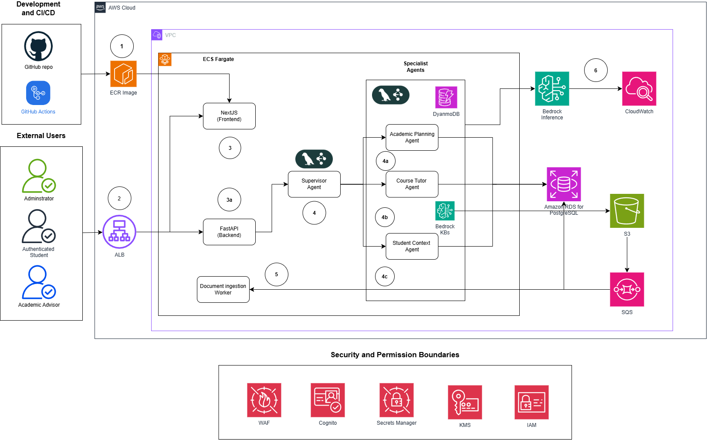

# Course Finder Agent HLD in AWS

## High-Level Design

1. Application is deployed to AWS as an **ECR** image with GitHub actions orchestrating the CI/CD workflows. 
2. The Application Load Balancer routes the uses requests to the main app with Gradio as the MVP frontend UI and FastAPI as the backend. Next.js is a planned replacement frontend

3. The full-stack application will run on **Amazon ECS** on **Fargate**. This is based on the assumption that the institution uses a hybrid infrastructure which allow portability to native Kubernetes in on-prem environment.   </n>
    3a. The current FastAPI backend uses deterministic regex-based intent routing. In the target architecture, it routes user queries to a LangGraph supervisor agent running on **Amazon ECS**. The supervisor agent acts as the orchestrator that analyses the user queries and determines the appropriate specialized agent to handle the request.
4. In the target architecture, the LangGraph supervisor agent analyses the user query to determine intent and routes it to the appropriate specialized sub-agent based on the request type. Each specialised agent uses a **DynamoDB** based checkpoint saver implementation for LangGraph to maintain conversational context. Only the `Course Tutor Agent` retrieves course material from the Knowledge bases; the `Academic Planning Agent` uses structured academic records for planning. 

    4a. The `Academic Planning Agent` handles the queries for student to determine which courses to take based on their enrolment status, degree requirement and course catalog.   
    4b. The `Course Tutor Agent` allows student to understand the learnings from the course materials provided. Bedrock generates an explaination grounded in retrieved material. 
    4c. The `Student Context Agent` retrieves student's academic history and current enrolments 
5. **Cloudwatch** metrics enables LLM inference to evaluate model performance
6. **SQS** handles queues for manual uploads by Adminstrators to update the knowledge bases for each specialized agent.

## Security and Permission Boundaries

* **WAF** - Web application firewall to prevent SQL injection and XSS
* **ACM** - SSL certifcation for HTTPS and mTLS config

* **Cognito User Pools** - Planned user sign-in and token issuance; token verification remains a pending release task. Server-side application policy checks enforce student and adviser record scope.

* **Secrets Manager** - manages credentials for RDS databases
* **KMS** - manages encryption for data at rest
* **IAM** - role-based access controls and permission policies

## Miscellaneous
- **AWS Amplify** - serves as the entry point for all interactions and validates the request and routes to **AWS Lambda** resolver function for processing
- **DynamoDB** to store sessions data and user interaction history as key-value pairs 
- Another **AWS Lambda** triggers manual uploads from Administrators to S3 bucket and updates Bedrock knowledge bases